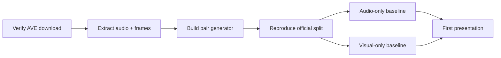

# AValidate: Intelligent Audio-Visual Source Matching — Complete Project Dossier

> **NUS Institute of Systems Science — Graduate Certificate in Pattern Recognition Systems**
> **Practice Module Project · Canvas Group 25 · October 2026**

| Team Member | NUS Student ID |
| :--- | :--- |
| Veeramani Mahadevan Venkata Ganapathi Subramanian | A0355739M |
| Gupta Swaraj | A0357457N |
| Ramia Kasthurirangam Pandurengan Ghanshyam | A0357701E |

---

## Table of Contents

1. [Executive Summary](#1-executive-summary)
2. [What — The Problem](#2-what--the-problem)
3. [Why — Motivation & Market Context](#3-why--motivation--market-context)
4. [How — System Architecture & Implementation](#4-how--system-architecture--implementation)
5. [Data Strategy](#5-data-strategy)
6. [Training Pair Construction](#6-training-pair-construction)
7. [Model Strategy & ML Techniques](#7-model-strategy--ml-techniques)
8. [Evaluation Plan](#8-evaluation-plan)
9. [Application & User Interface](#9-application--user-interface)
10. [Team Roles & Responsibilities](#10-team-roles--responsibilities)
11. [Development Plan & Timeline](#11-development-plan--timeline)
12. [Module Requirements Mapping](#12-module-requirements-mapping)
13. [Shortcomings & Limitations](#13-shortcomings--limitations)
14. [Risks, Challenges & Mitigations](#14-risks-challenges--mitigations)
15. [Plan of Action (Recommended)](#15-plan-of-action-recommended)
16. [Recommendations](#16-recommendations)
17. [References](#17-references)
18. [Document Provenance](#18-document-provenance)

---

## 1. Executive Summary

**AValidate** is a multimodal AI system that simultaneously *listens to* and *watches* a short video clip. Rather than classifying audio and video independently, it learns whether the visible event is the actual source of the observed sound — answering the central research question:

> *"Does what I hear make sense given what I see?"*

For every input clip the system outputs five things:

1. **Predicted sound/event class** (28 categories)
2. **Per-second audible-and-visible presence** (when the event is both heard and seen)
3. **Audio confidence score**
4. **Visual confidence score**
5. **Audio-visual correspondence score** → Strong Match / Weak-Uncertain / Mismatch

The system uses two pretrained transformer encoders — **BEATs** (audio) and **CLIP ViT-B/16** (vision) — both adapted with **LoRA** (Low-Rank Adaptation), temporally aligned at one-second resolution, fused via concatenation + MLP (with optional cross-modal attention), and trained end-to-end with three output heads. The correspondence score is learned from programmatically generated match/mismatch pairs, not from hand-written rules.

The core MVP accepts uploaded video clips via a **Streamlit** interface. A live webcam+microphone mode is explicitly scoped as a stretch goal.

---

## 2. What — The Problem

### 2.1 Problem Statement

Develop a multimodal audio-visual system that:
- **Identifies** a sound event from the audio track of a video
- **Localises it in time** (second-by-second)
- **Verifies** whether the visual scene is consistent with the identified sound

### 2.2 The Four Questions the System Answers

For every input clip, the system answers:

| # | Question | Output |
|---|----------|--------|
| 1 | What sound/event is present? | Event class from 28 categories |
| 2 | When is the event both audible and visible? | Per-second binary timeline |
| 3 | How confident are the predictions? | Audio confidence + Visual confidence |
| 4 | Do audio and visual observations correspond? | Correspondence score with Strong/Weak/Uncertain banding |

### 2.3 What This Is NOT

- **Not** a standard audio classifier — it explicitly evaluates cross-modal agreement
- **Not** an object detector — it doesn't claim that a visible object physically generated a sound
- **Not** a deepfake detector — although the principles could extend to detecting dubbed/manipulated media
- "Low correspondence" means **weak visual evidence**, not that the predicted sound is impossible

### 2.4 Representative Scenarios

| Scenario | Visual | Audio | Expected Result |
|----------|--------|-------|-----------------|
| Genuine match | Dog visible | Dog bark | **Strong correspondence** |
| Genuine match | Car visible | Car horn | **Strong correspondence** |
| Clear mismatch | Dog visible | Siren | **Low / Mismatch** |
| Ambiguous/imitation | Person visible | Dog-bark imitation | **Weak / Uncertain** |
| Off-screen source | Person/environment | Siren (off-screen) | **Low / Uncertain** |
| Multiple objects | Dog + Car visible | Dog bark | **Strong** (if dog evidence dominates) |
| Occluded source | Partially visible dog | Dog bark | **Medium-High** (depending on evidence) |

---

## 3. Why — Motivation & Market Context

### 3.1 The Gap

Existing audio classification and visual recognition systems can independently identify *what is heard* and *what is seen*, but **independent predictions do not directly answer whether the visible source actually corresponds to the dominant audio**. A dog may be visible while a siren is heard; a person may appear while a dog bark dominates the audio; an off-screen source may produce the sound.

### 3.2 The Opportunity

A system that reasons across both modalities can answer questions that neither modality alone can:
- Is the visible object the source of the sound?
- Should I trust this audio-visual pairing?
- Is this video clip genuine or manipulated?

### 3.3 Real-World Applications

- **Video search and tagging** — more accurate metadata by verifying audio-visual consistency
- **Content moderation** — detecting dubbed or manipulated video
- **Surveillance event checks** — verifying whether alarms correspond to visible events
- **Cleaning audio-visual training data** — filtering mismatched pairs in large datasets

### 3.4 Published Evidence

Published results on the chosen AVE dataset quantify the value of multimodal fusion:
- Audio-only: **59.5%** accuracy
- Visual-only: **65.0%** accuracy
- Audio + Visual: **74.0%** accuracy

*(Tian et al., ECCV 2018)*

---

## 4. How — System Architecture & Implementation

### 4.1 High-Level Architecture

```
+-------------------------------------------------------------------+
|                            Input Video                            |
|                     (10 s clip / live stream)                     |
+---------------------------------+---------------------------------+
                                  |
        +-------------------------+-------------------------+
        |                                                   |
        v                                                   v
+---------------+                                   +---------------+
| Audio Branch  |                                   | Visual Branch |
| Log-Mel /     |                                   | Frames /      |
| BEATs + LoRA  |                                   | CLIP ViT-B/16 |
+-------+-------+                                   +-------+-------+
        |                                                   |
        +-------------------------+-------------------------+
                                  |
                                  v
                     +--------------------------+
                     |    Aligned Embeddings    |
                     | (1 fps temporal alignm.) |
                     +------------+-------------+
                                  |
                                  v
                     +--------------------------+
                     |          Fusion          | ===> [ Optional Upgrade:  ]
                     |       Concat + MLP       |      [ Cross-Modal Attn. ]
                     +------------+-------------+
                                  |
        +-------------------------+-------------------------+
        |                         |                         |
        v                         v                         v
+---------------+       +-------------------+       +---------------+
|    Head 1     |       |      Head 2       |       |    Head 3     |
|  Event Class  |       | Audible + Visible |       | Corres. Score |
|  (28 cats.)   |       | Per-sec Presence  |       | MATCH/MISMATCH|
+-------+-------+       +---------+---------+       +-------+-------+
        |                         |                         |
        +-------------------------+-------------------------+
                                  |
                                  v
                     +--------------------------+
                     |    Streamlit Interface   |
                     | Result+Confidence+Timeln |
                     +--------------------------+
```

### 4.2 Component Breakdown

#### Audio Branch
| Aspect | Detail |
|--------|--------|
| **Input** | Audio track extracted from video → mono, fixed sample rate |
| **Feature extraction** | Log-Mel spectrogram |
| **Baseline encoder** | Small CNN on log-Mel features |
| **Main encoder** | **BEATs** (AudioSet-pretrained audio transformer) |
| **Adaptation** | **LoRA** adapters (rank ablation: r = 4, 8, 16) |
| **Output** | One audio embedding per second + event evidence |

#### Visual Branch
| Aspect | Detail |
|--------|--------|
| **Input** | Video frames sampled at 1 fps (10 frames per 10s clip) |
| **Baseline encoder** | ResNet/EfficientNet features |
| **Main encoder** | **CLIP ViT-B/16** (vision-language pretrained transformer) |
| **Adaptation** | **LoRA** adapters |
| **Output** | One visual embedding per second |
| **Optional overlay** | COCO-pretrained object detector for visualization only (not part of core pipeline) |

#### Temporal Alignment
- Audio and visual embeddings are aligned at **1-second resolution**
- Each second of audio is paired with the frame from the same timestamp
- Produces 10 aligned (audio, visual) embedding pairs per 10-second clip

#### Fusion Module
| Version | Method | Detail |
|---------|--------|--------|
| **v1 (baseline)** | Late fusion | Concatenate aligned embeddings → MLP |
| **v2 (upgrade)** | Cross-modal attention | Each modality attends to the other |

#### Three Output Heads
| Head | Task | Labels | Loss |
|------|------|--------|------|
| **Head 1** | Event classification | 28 AVE categories | Cross-entropy (softmax) |
| **Head 2** | Per-second presence | Audible-and-visible vs. background | Binary cross-entropy per second |
| **Head 3** | Correspondence score | Match/Mismatch probability | Binary cross-entropy on generated pairs |

### 4.3 Interface Agreement

Fixed in Week 1 to enable parallel development:

```python
def predict(video_path: str) -> dict:
    """
    Returns:
        {
            "event_class": str,           # predicted event category
            "event_confidence": float,     # audio confidence
            "per_second_labels": list,     # 10 binary labels
            "correspondence_score": float, # 0.0 to 1.0
            "correspondence_band": str,    # "Strong" / "Weak" / "Uncertain"
            "visual_confidence": float,
            "audio_embedding": tensor,
            "visual_embedding": tensor,
        }
    """
```

Until real checkpoints exist, this returns stub values so the front-end and evaluation harness can be built immediately.

### 4.4 Technical Stack

| Category | Tools |
|----------|-------|
| Language | Python |
| Deep Learning | PyTorch, Hugging Face Transformers |
| Audio Processing | torchaudio, librosa |
| Video/Image Processing | OpenCV, torchvision, ffmpeg |
| ML Utilities | scikit-learn, Pandas, NumPy |
| Visualization | Matplotlib |
| Application | Streamlit |
| Experiment Tracking | Weights & Biases or TensorBoard (optional) |

---

## 5. Data Strategy

### 5.1 Dataset Overview

| Dataset | Role | Details | Status |
|---------|------|---------|--------|
| **AVE (Audio-Visual Event)** | **Primary** | 4,143 ten-second clips, 28 categories, per-second event/background labels, official train/val/test split, single download | **CORE** |
| **Generated Pairs** | Correspondence supervision | Positives (original clip) + Negatives (audio-swapped), including hard negatives from acoustically similar categories | **CORE** — script-generated |
| **VGGSound** | Scale-up/fallback | 200k+ clips, 310+ classes; available via Hugging Face mirror (Loie/VGGSound) | **OPTIONAL** — only if AVE is too small |
| **VGG-SS** | Source localisation evaluation | ~5k clips with visible sound-source bounding boxes across 220 classes | **OPTIONAL** — evaluation only, never for training |
| **COCO** | Object detection overlay | 80 common object categories | **OPTIONAL** — visualisation aid only |
| **AudioSet** | Supplementary audio | 2M+ clips, 527 classes | **NOT PLANNED** — AVE is already an AudioSet subset |

### 5.2 AVE Event Categories (28 classes)

The full AVE benchmark set covers: church bell, dog bark, man speaking, violin, helicopter, frying food, train horn, motorcycle, and 20 others spanning human activity, animals, musical instruments, and vehicles. Using the complete benchmark keeps results comparable with published literature.

### 5.3 Preprocessing Pipeline

| Step | Operation | Detail |
|------|-----------|--------|
| 1 | Extract audio | Mono, one fixed sample rate |
| 2 | Sample frames | At timestamps aligned to each second (1 fps) |
| 3 | Map labels | Per-second event / background annotations |
| 4 | Build pairs | Positives and three kinds of negatives |
| 5 | Store splits | Reproducible, versioned train / val / test |

> [!IMPORTANT]
> **No leakage policy:** Every clip belongs to one split, and negatives only borrow audio from clips in the **same split**, never across splits. The official AVE train/val/test partition is strictly respected.

---

## 6. Training Pair Construction

A critical design decision (revised from v1 where correspondence was hand-built) — correspondence is now a **trained, supervised task**:

### 6.1 Pair Types

| Pair Type | Construction | Label | Purpose |
|-----------|-------------|-------|---------|
| **Positive** | Clip with its own soundtrack | MATCH | Ground-truth alignment |
| **Easy Negative** | Video paired with audio from a different category (e.g., dog video + siren audio) | MISMATCH | Easy to reject; baseline difficulty |
| **Hard Negative** | Video paired with audio from acoustically similar category (e.g., guitar video + banjo audio; truck + bus) | MISMATCH | Forces model to use actual audio-visual evidence, not just category agreement |
| **Time-Shifted** | Video with its own audio delayed by ~3 seconds | MISMATCH | Right sound, wrong moment; tests temporal sensitivity |

### 6.2 Match Definition

> **"Match"** is defined as **same-class audio** (not necessarily the exact same soundtrack), because that reflects the question the system is meant to answer — is the visible event consistent with the type of sound?

This formulation follows the established audio-visual correspondence protocol from Arandjelovic & Zisserman, "Look, Listen and Learn" (ICCV 2017).

---

## 7. Model Strategy & ML Techniques

### 7.1 Progressive Development Stages

| Stage | Approach | Purpose |
|-------|----------|---------|
| **Stage 1 — Baselines** | Log-Mel CNN (audio) + ResNet/EfficientNet (visual) | Establish floor performance |
| **Stage 2 — Frozen pretrained** | BEATs + CLIP with only lightweight heads | Confirm pipeline works end-to-end |
| **Stage 3 — LoRA fine-tuning** *(main contribution)* | LoRA adapters on both encoders, joint training with fusion and 3 heads, rank ablation (r=4,8,16) | Primary modelling contribution |
| **Stage 4 — Advanced fusion** | Cross-modal attention (if time permits) | Explore richer interaction patterns |

### 7.2 Why LoRA?

- Freezes large pretrained weights → trains only small add-on matrices
- Fits on a single student GPU
- Models are still **genuinely fine-tuned** (unlike frozen feature extraction)
- Enables meaningful **rank ablation** experiments

### 7.3 Correspondence Scoring (Revised from v1)

| Aspect | v1 (Original) | v2 (Revised) |
|--------|---------------|--------------|
| Method | Hand-written object-to-sound compatibility table | Learned shared embedding space |
| Labels | Small hand-built test set | Thousands of programmatically generated pairs |
| Decision | Rule-based lookup | Cosine similarity → trained match probability |
| Thresholds | Chosen arbitrarily | Calibrated on validation split |

**v1's hand-written approach was explicitly removed** because it was "rule-based, brittle beyond a handful of classes, and would not demonstrate deep learning."

### 7.4 Technique Mapping to Module Requirements

| Required Aspect | How AValidate Addresses It |
|-----------------|---------------------------|
| **Supervised / unsupervised learning** | Event classification and per-second labels are supervised (AVE annotations). Correspondence labels are generated from data itself — self-supervised in style, no manual annotation |
| **Machine learning / deep learning** | Two pretrained transformers fine-tuned with LoRA, plus CNN baselines for comparison |
| **Hybrid / ensemble approach** | Cross-modal fusion of two independently encoded modalities, plus multi-task heads |
| **Intelligent sensing / sense-making** | Two sensor streams (microphone + camera) interpreted jointly; the per-second timeline and correspondence score are the sense-making output |

> The module requires at least three of four aspects; this design covers **all four**.

---

## 8. Evaluation Plan

### 8.1 Quantitative Experiments

| # | Experiment | Question | Comparison | Measures |
|---|-----------|----------|------------|----------|
| 1 | Unimodal event recognition | Does each branch recognise events on its own? | Lightweight baseline vs. pretrained/adapted encoders | Accuracy, Macro-F1, confusion matrix |
| 2 | Audio-visual correspondence | Does fusion add anything over two separate classifiers? | Label-agreement baseline vs. learned fusion (simple vs. attention) | ROC-AUC, PR-AUC, F1 at validation-selected threshold |
| 3 | Negative difficulty | Does it still work when the mismatch is subtle? | Easy vs. hard (similar-category, time-shifted) negatives | ROC-AUC per negative type |
| 4 | Temporal presence | Does it find the right seconds? | Per-second predictions vs. AVE event/background labels | Per-second F1 |
| 5 | Confidence reliability | Can the confidence be trusted? | Raw vs. calibrated correspondence scores | Expected Calibration Error (ECE), reliability diagram |

### 8.2 Ablation Studies

| Model | Evidence | Purpose |
|-------|----------|---------|
| Audio-only | Audio | How well sound alone identifies the event |
| Visual-only | Frames | How well vision alone identifies the event |
| Audio + Video (frozen encoders) | Both | Benefit of multimodal evidence |
| Audio + Video (LoRA fine-tuned) | Both | Benefit of fine-tuning over frozen features |
| Audio + Video + correspondence head | Both + cross-modal | **The main contribution** |
| Multi-task vs single-task | Both | Whether training all three heads together helps or hurts |

> **Reference ablation points** from AVE paper: Audio-only 59.5% / Visual-only 65.0% / Fused 74.0%

### 8.3 Robustness Tests

- Audio noise injection (varying SNR)
- Frame blur
- Frame dropout
- Partial visual obstruction/occlusion

### 8.4 Error Analysis

- False matches / false mismatches
- Occlusion cases
- Off-screen sources
- Imitation cases (qualitative demo only — no labelled data exists)
- Multiple simultaneous objects

> [!WARNING]
> **Misleading per-second accuracy:** Simply repeating one clip-level label across all ten seconds already scores 82.2% per-second accuracy while never detecting a single background second. **Background-class F1 must be reported alongside accuracy** to avoid this trap.

### 8.5 Headline Result

**Correspondence ROC-AUC on hard negatives**, compared with the label-agreement baseline.

---

## 9. Application & User Interface

### 9.1 Streamlit MVP Features

1. Upload a short video clip
2. Display the uploaded video
3. Extract audio automatically
4. Show predicted event class and audio confidence
5. Show a per-second timeline strip marking when the event is audible and visible
6. Show sampled frames (optionally with detected object overlays)
7. Show audio-visual correspondence score
8. Show interpretive assessment: **Strong Match / Weak Match / Uncertain**
9. **"Swap the Audio" button** — pairs the video with another clip's soundtrack so the audience can watch the correspondence score collapse live

### 9.2 Example UI Output

```
Predicted sound:           Dog bark
Audio confidence:          91%
Candidate source:          Dog
Visual/source confidence:  88%
Audio-visual correspondence: 93%
Assessment:                STRONG CORRESPONDENCE
```

### 9.3 Webcam + Microphone Mode (Stretch Goal)

**Demoted from live Streamlit feature to pre-recorded demonstration clip.**

Rationale: Live microphone capture in Streamlit is unreliable, carries no marks, and risks the graded deliverables. Instead, a short screen capture of the pipeline running on self-recorded clips will be produced if the core system finishes early.

---

## 10. Team Roles & Responsibilities

### 10.1 Role Distribution

| Member | Model Work | App Work | Man-days |
|--------|-----------|----------|----------|
| **Ghanashyam** | BEATs + LoRA audio encoder, cross-modal attention fusion, three output heads, LoRA rank ablation | Inference layer: checkpoint loading, `predict()` entry point, latency/caching | 10 |
| **Member 2 (Swaraj)** | CLIP ViT + LoRA visual branch, visual-only baseline, robustness experiments | Front end: upload flow, video player, frame strip, per-second timeline, swap-audio button | 10 |
| **Member 3 (Veeramani)** | AVE pipeline and match/mismatch pair generator, audio CNN baseline, evaluation harness, ablation runs | Results view: metrics and confusion matrices in the app, packaging, demo recording | 10 |
| **All** | Report, presentations, video, individual reports and peer review | (within the above) | — |

### 10.2 Design Principle

Every member:
- **Trains** a model component (so everyone has model work for the individual reflection report)
- **Owns** a slice of the Streamlit app (so no one is just "the app person")

The audio branch is paired with the fusion module because that is where most of the architecture work sits.

---

## 11. Development Plan & Timeline

### 11.1 Phased Development (30 man-days total)

| Phase | Work | Man-days |
|-------|------|----------|
| 1 — Data | Download AVE, verify integrity, extract frames at 1 fps, build pair generator, reproduce official split | 3 |
| 2 — Baselines | Audio-only and visual-only baselines | 3 |
| 3 — Pretrained (frozen) | BEATs and CLIP embeddings + light heads, end-to-end pipeline working | 3 |
| 4 — LoRA fine-tuning | Adapters on both encoders, joint training with fusion and three heads, rank ablation | **7** |
| 5 — Fusion + heads | Late fusion → cross-modal attention; correspondence head | 3 |
| 6 — Evaluation | Ablations, robustness, error analysis, results tables | 3 |
| 7 — MVP | Streamlit app and demo assets | 3 |
| 8 — Deliverables | Report, 10-15 min video, slides, individual reports, peer review | 3 |
| Buffer | Unallocated contingency | 2 |
| **Total** | | **30** |

### 11.2 Key Milestones

| Date | Milestone |
|------|-----------|
| **30 Sep 2026** | Project proposal submitted |
| **6 Oct 2026** | First presentation (9am–6pm, Zoom): problem, data, baselines, early results |
| **7–20 Oct 2026** | LoRA fine-tuning and fusion; **model results frozen on 20 Oct** |
| **21–25 Oct 2026** | Evaluation, Streamlit MVP, demo assets |
| **26–31 Oct 2026** | Report, video, slides; final submission (one ZIP) by **31 Oct** |

> [!IMPORTANT]
> **Hard freeze:** Model work freezes on **20 Oct**. The final 10 days are writing and integration only. This protects against the IRS module deadline clash (25 Oct).

---

## 12. Module Requirements Mapping

| Required Aspect | Where It Appears in AValidate |
|-----------------|-------------------------------|
| Supervised / unsupervised learning | Supervised: event class and per-second labels. Self-supervised: correspondence labels generated from data without human annotation |
| Machine learning / deep learning | Two pretrained transformers fine-tuned with LoRA, plus CNN baselines for comparison |
| Hybrid / ensemble approach | Cross-modal fusion of two independently encoded modalities, plus multi-task heads |
| Intelligent sensing / sense-making | Two sensor streams (microphone and camera) interpreted jointly; per-second timeline and correspondence score are the sense-making output |

**All four aspects are covered** (module requires at least three).

---

## 13. Shortcomings & Limitations

### 13.1 Fundamental Limitations

| Limitation | Detail |
|-----------|--------|
| **Cannot prove physical causation** | A low correspondence score means weak visual evidence, not that the predicted sound is impossible. The system cannot prove that a visible object physically generated a sound. |
| **Off-screen source ambiguity** | Off-screen sources, occlusion, background sounds, and multiple simultaneous sources make correspondence inherently ambiguous. |
| **No real-world manipulated media testing** | Generated negatives are synthetic audio swaps, not deliberately edited/dubbed video. Performance on real-world deepfakes or manipulated media is untested. |
| **Imitation cases are qualitative only** | No dataset contains labelled imitation clips (e.g., person imitating a dog bark). These are demonstrated but not measured. |
| **Benchmark ≠ deployment** | AVE is a benchmark of unconstrained YouTube clips. Results are benchmark results, not evidence of deployment readiness. |
| **Per-second accuracy is misleading alone** | Repeating a single clip-level label scores 82.2% per-second accuracy. Background-class F1 is essential alongside accuracy. |

### 13.2 Data Limitations

| Issue | Impact |
|-------|--------|
| AVE has only 4,143 clips across 28 categories | Limited scale; some categories may be under-represented |
| VGGSound's official download is no longer available | Must use Hugging Face mirror, raising potential data provenance questions |
| VGG-SS is a test benchmark only | Cannot be used for training; only for qualitative evaluation |
| No fine-grained object-to-sound annotations | VGGSound is not a complete frame-by-frame object-to-sound-source annotation dataset |

### 13.3 Model Limitations

| Issue | Impact |
|-------|--------|
| LoRA is parameter-efficient but not full fine-tuning | May miss some adaptation potential of full fine-tuning |
| Late fusion may miss early interaction patterns | Concatenation + MLP doesn't capture cross-modal interactions at feature level |
| Single-frame sampling at 1 fps | Misses motion cues and fast events |
| No speech content understanding | Cannot distinguish semantic speech content, only that speech is present |

---

## 14. Risks, Challenges & Mitigations

| Risk | Why It Matters | Mitigation |
|------|---------------|------------|
| **AVE download link (Google Drive) is dead or slow** | Blocks the entire project data pipeline | Verify in week 1. Fallback: VGGSound subset from HuggingFace mirror with correspondence pairs generated the same way; per-second labels dropped (project runs with 2 outputs instead of 3) |
| **Too many models/modalities** | Integration and training become too slow | Frozen encoders + late fusion first; LoRA only after pipeline runs end-to-end |
| **Complex fusion too early** | Hard to debug and explain | Concatenation → attention, in that order |
| **GPU availability** | Student GPUs may be insufficient | LoRA keeps memory modest; Azure/Google student credits requested in week 1 |
| **Class imbalance** | Accuracy can hide poor minority-class performance | Macro F1, class weights, per-class analysis |
| **Data leakage** | Inflated results | Official splits; negatives generated within a split, never across |
| **Misleading per-second accuracy** | Trivial baseline gets 82.2% | Report background-class F1 alongside accuracy |
| **Live mode consumes time** | Could jeopardize graded deliverables | Recorded demo instead of live capture |
| **IRS module deadline clash (25 Oct)** | Competing priorities | Model work freezes on 20 Oct; final week is writing and integration only |
| **Dataset too large** | Storage and processing impractical | Use documented 8-15 class subset (if using VGGSound) or full AVE (4,143 clips is manageable) |
| **Source labels incomplete** | VGGSound lacks frame-level source annotations | Use VGG-SS plus documented custom correspondence evaluation set |

---

## 15. Plan of Action (Recommended)

Based on synthesis of all project documents, here is the recommended execution plan:

### Phase 1: Foundation (Week 1 — by 6 Oct)



- [ ] Download and verify AVE dataset integrity
- [ ] Set up reproducible preprocessing pipeline (audio extraction, frame sampling at 1 fps, label mapping)
- [ ] Build the positive/negative pair generator (easy + hard + time-shifted negatives)
- [ ] Implement stub `predict()` interface so all three members can work in parallel
- [ ] Implement audio-only baseline (Log-Mel CNN)
- [ ] Implement visual-only baseline (ResNet/EfficientNet features)
- [ ] Request GPU credits (Azure/Google)
- [ ] **Deliver first presentation (6 Oct)**

### Phase 2: Core Model Development (7–20 Oct)

- [ ] Integrate BEATs (frozen) with lightweight heads → verify end-to-end
- [ ] Integrate CLIP ViT-B/16 (frozen) with lightweight heads → verify end-to-end
- [ ] Insert LoRA adapters into both encoders
- [ ] Implement late fusion (concatenation + MLP)
- [ ] Train jointly with all three output heads
- [ ] Run LoRA rank ablation (r = 4, 8, 16)
- [ ] Compare frozen vs. LoRA-adapted performance
- [ ] If time permits: implement cross-modal attention fusion
- [ ] **Model results frozen on 20 Oct**

### Phase 3: Evaluation & MVP (21–25 Oct)

- [ ] Run all ablation experiments (6 configurations)
- [ ] Generate evaluation tables and confusion matrices
- [ ] Robustness tests (noise, blur, frame dropout)
- [ ] Error analysis (false matches/mismatches, edge cases)
- [ ] Compute ECE and reliability diagrams
- [ ] Build Streamlit application (upload flow, video player, timeline, swap-audio button)
- [ ] Record demo assets (including imitation cases)
- [ ] Integration testing

### Phase 4: Deliverables (26–31 Oct)

- [ ] Write final project report
- [ ] Create 10-15 minute video
- [ ] Prepare final presentation slides
- [ ] Individual reflection reports
- [ ] Peer review
- [ ] Package and submit (one ZIP by **31 Oct**)

---

## 16. Recommendations

Based on a thorough analysis of all project documentation, the following recommendations are offered:

### 16.1 Architecture Recommendations

> [!TIP]
> **Start simple, upgrade incrementally.** The late fusion (concat + MLP) baseline should be fully working and evaluated before attempting cross-modal attention. The staged approach (baseline → frozen pretrained → LoRA) is well-designed and should be strictly followed.

1. **Prioritise the correspondence head** — it is the headline differentiator. Event classification and per-second presence can be found in existing literature; the learned correspondence scoring is the project's unique contribution.

2. **Consider a lightweight temporal model** — a 1D convolution or small transformer over the 10 time-step sequence could capture temporal dynamics better than frame-independent fusion. This is a low-cost experiment that could improve per-second presence prediction significantly.

3. **Implement the "swap audio" button early** — this is an extremely compelling demo feature that directly shows the system's value and should not be left to the last day.

### 16.2 Data Recommendations

4. **Verify AVE download immediately** — this is the single biggest risk. Have the VGGSound fallback plan ready to execute with zero delay.

5. **Log every preprocessing decision** — sample rate, spectrogram parameters, frame extraction method, normalisation, augmentation. These are needed for reproducibility and the report.

6. **Create a "hard negative" difficulty sweep** — vary the semantic distance between swapped categories to produce a difficulty curve, not just easy/hard buckets. This gives richer analysis.

### 16.3 Evaluation Recommendations

7. **Always report background F1** — the 82.2% accuracy trap is real and would be immediately caught by reviewers.

8. **Calibrate correspondence scores properly** — use temperature scaling or Platt scaling on the validation set. The ECE and reliability diagram will be important evidence of practical utility.

9. **Create a "failure gallery"** — curate the most interesting failure cases (false matches, false mismatches, ambiguous cases) as a dedicated section in the report. This demonstrates analytical maturity.

### 16.4 Process Recommendations

10. **Enforce the 20 Oct model freeze** — this is the single most important schedule discipline. The temptation to keep tuning will be strong; resist it.

11. **Build the Streamlit app with stub outputs from day 1** — the interface agreement is already defined. Having a working UI early enables integration testing throughout development, not just at the end.

12. **Record the demo video before writing the report** — the video forces you to articulate results clearly, which makes report-writing faster.

### 16.5 Stretch Goals (Only After Core Is Complete)

| Priority | Extension |
|----------|-----------|
| 1st | Object-detection overlay in Streamlit (COCO-pretrained, visualisation only) |
| 2nd | VGG-SS localisation qualitative check |
| 3rd | Cross-modal attention (if concat+MLP is already working) |
| 4th | Robustness study with quantitative noise/blur sweeps |
| 5th | Recorded webcam demo (never live in-app) |
| Last | VGGSound scale-up (only if AVE results motivate it) |

### 16.6 Things to Watch Out For

> [!CAUTION]
> - **Do not** build a hand-written object-to-sound compatibility table — this was explicitly removed in v2 because it is rule-based and brittle.
> - **Do not** report imitation cases as measured results — no labelled data exists for these; they are qualitative demos only.
> - **Do not** use VGG-SS for training — it is a test benchmark only.
> - **Do not** attempt live webcam capture in Streamlit — it is unreliable and risks graded deliverables.

---

## 17. References

1. Tian, Y., Shi, J., Li, B., Duan, Z., Xu, C. "Audio-Visual Event Localization in Unconstrained Videos." *ECCV*, 2018. *(AVE dataset and baseline numbers: 59.5 / 65.0 / 74.0)*
2. Zhou, J. et al. Corrected AVE test-set annotations (2021). *(Use for final evaluation)*
3. Arandjelovic, R., Zisserman, A. "Look, Listen and Learn." *ICCV*, 2017. *(Audio-visual correspondence task formulation)*
4. Chen, H. et al., "VGGSound: A Large-scale Audio-Visual Dataset." *ICASSP*, 2020.
5. Chen, H. et al., "Localizing Visual Sounds the Hard Way." *CVPR*, 2021.
6. Chen, S. et al., "BEATs: Audio Pre-Training with Acoustic Tokenizers." *ICML*, 2023.
7. Radford, A. et al., "Learning Transferable Visual Models From Natural Language Supervision." *ICML*, 2021.
8. Hu, E. et al., "LoRA: Low-Rank Adaptation of Large Language Models." *ICLR*, 2022.

### Dataset Links

| Dataset | URL |
|---------|-----|
| VGGSound | https://www.robots.ox.ac.uk/~vgg/data/vggsound/ |
| VGGSound (HF mirror) | https://huggingface.co/datasets/Loie/VGGSound |
| VGG-SS | https://www.robots.ox.ac.uk/~vgg/research/lvs/ |
| AudioSet | https://research.google.com/audioset/ |
| COCO | https://cocodataset.org/ |

---

## 18. Document Provenance

This final dossier was synthesised from the following source documents in the project repository:

| Document | Type | Content |
|----------|------|---------|
| `project_proposal_report.md` | Markdown | Official submitted project proposal |
| `1 Audio_Visual_Sound_Source_Verification_Team_Report.docx` | Word | Original team planning report (v1) — concept, data strategy, system design, test cases, MVP plan |
| `2 AV_SoundSource_Report_v2_REVISED-2.docx` | Word | Revised team report (v2) — trained correspondence, LoRA, AVE pivot, delivery plan, effort budget, timeline |
| `3 AValidate_Technique_Mapping.docx` | Word | Module requirements mapping (all four aspects covered) |
| `PRS-Proporsal V1.docx` | Word | Formal proposal version 1 (submitted) |
| `PRS-Proporsal V3.docx` | Word | Formal proposal version 3 (revised with model-agnostic language) |
| `Group 25 - AValidate - First Presentation V1.pptx` | PowerPoint | First presentation slides (14 slides) — presented 6 Oct 2026 |
| `AValidate-Presentation-Script2.pdf` | PDF | Presentation script (binary — text extraction limited) |
| `Meeting Notes - 27 Sep 2026.pdf` | PDF | Meeting minutes (binary — text extraction limited) |

> **AI Tool Declaration:** ChatGPT and Claude were used by the team to review and refine the proposed architecture, structure the proposal, improve technical expression, and prepare diagrams. All model choices, dataset selections, implementation decisions, experiments, and final content were reviewed and approved by the project team. This dossier was compiled by an AI assistant from the team's own documents.

---

*Last updated: 5 October 2026*
