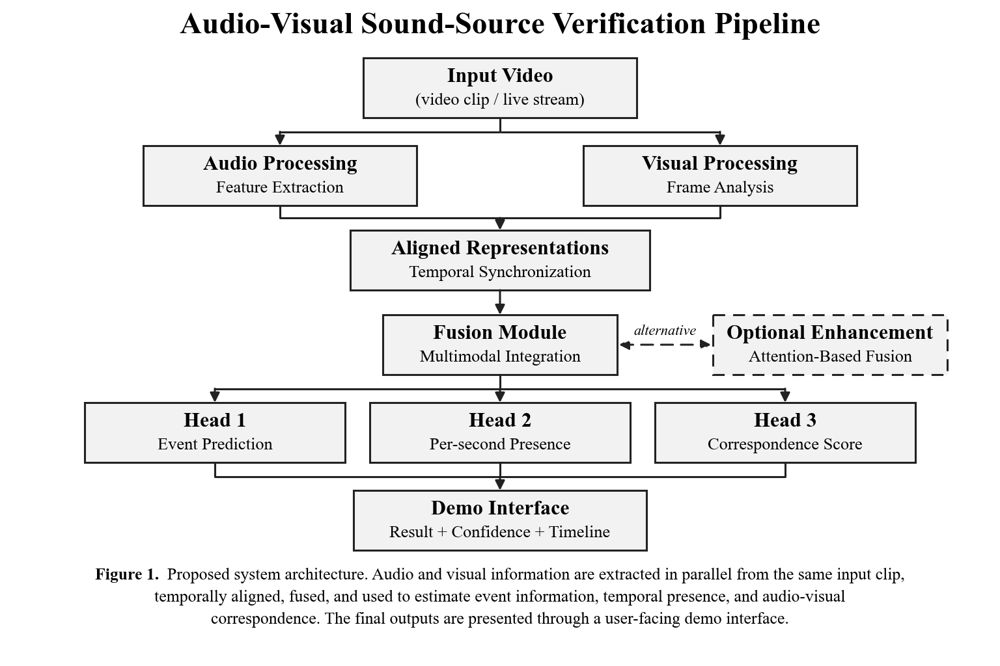

# NATIONAL UNIVERSITY OF SINGAPORE
## Institute of Systems Science
### Graduate Certificate in Pattern Recognition Systems
**Practice Module Project Proposal**

# AValidate: Intelligent Audio-Visual Source Matching

**Canvas Group Number:** 25

**Team Members:**

| Team Member | NUS Student ID |
| :--- | :--- |
| Veeramani Mahadevan Venkata Ganapathi Subramanian | A0355739M |
| Gupta Swaraj | A0357457N |
| Ramia Kasthurirangam Pandurengan Ghanshyam | A0357701E |

> **Proposal Note:** The proposed architecture, datasets, model configurations and team responsibilities represent the current design baseline and may be refined during implementation based on experimental findings, data availability and technical feasibility.

---

## 1. Problem, Motivation & Market Context

Real-world video understanding becomes unreliable when a visible object or event is assumed to be the source of the sound simply because the two occur together. A dog may be visible while a siren is heard, a person may appear while a dog bark dominates the audio, or an off-screen source may produce the sound. A useful intelligent system therefore needs to reason across both modalities rather than classify audio and video independently.

Existing audio classification and visual recognition systems can identify what is heard or seen, but independent predictions do not directly answer whether the visible source actually corresponds to the dominant audio. **AValidate** therefore focuses on audio-visual correspondence, learning aligned audio and visual representations and estimating whether they describe the same event at the same time.

The project investigates the following question:

> *Can synchronized audio and visual embeddings be fused to reliably verify whether the visible event is the source of the observed sound?*

The MVP will use the **AVE (Audio-Visual Event)** dataset as the primary source because it provides 4,143 ten-second audio-video clips across 28 event categories with per-second event/background annotations. **VGGSound** may be used as a scale-up or fallback source for selected overlapping classes, while **VGG-SS** can support optional qualitative sound-source localization evaluation.

### 1.1 Objectives and Scope

The MVP will:
* Extract synchronized audio and video information from each input clip;
* Encode the audio and visual streams into modality-specific representations, progressing from lightweight baselines to pretrained encoders;
* Align the two modalities at approximately one-second temporal resolution;
* Predict the event class and whether an event is both audible and visually present;
* Learn a cross-modal correspondence score for **MATCH / MISMATCH** verification;
* Evaluate positive pairs and deliberately mismatched audio-video pairs; and
* Present event confidence, temporal evidence and the final correspondence result in a simple interface.

Representative cases include *dog video + barking* (expected strong correspondence), *car + car horn* (strong correspondence), *dog video + siren or car horn* (mismatch), and *human/person video + dog bark* (low or uncertain correspondence rather than logical impossibility). A real-time webcam + microphone mode is treated as a final demonstration enhancement after the offline MVP is stable.

---

## 2. Proposed System Design

The system separates modality-specific representation learning from cross-modal verification. The audio and visual branches first produce embeddings independently; these embeddings are then temporally aligned and fused so that the final decision depends on their relationship rather than on either modality alone.

*Figure 1. Proposed system architecture. Audio and visual information are extracted in parallel from the same input clip, temporally aligned, fused, and used to estimate event information, temporal presence, and audio-visual correspondence. The final outputs are presented through a user-facing demo interface.*

* **Audio branch:** The audio stream is extracted from the input video and processed to obtain meaningful acoustic features. These features are used to identify sound events and capture temporal information from different segments of the clip. Candidate encoders range from lightweight spectrogram-based baselines to pretrained audio models (e.g., [4]).
* **Visual branch:** Video frames are sampled from the same input and processed to obtain visual features representing the objects, actors, and events present in the scene. The visual information is temporally aligned with the corresponding audio segments. Candidate encoders include pretrained vision or vision-language models (e.g., [5]).
* **Fusion and prediction heads:** The aligned audio and visual representations are combined using a multimodal fusion approach. The fused information is then used to estimate the event being observed, determine when relevant audio-visual activity is present, and calculate the correspondence between what is seen and what is heard.
* **Pair construction:** Original synchronized audio-video clips are treated as corresponding examples. Additional mismatched examples are created by pairing visual content with audio from unrelated events. These samples allow the system to learn the difference between matching and non-matching audio-visual content.

---

## 3. Data & Knowledge

| Source | Use |
| :--- | :--- |
| **AVE (Audio-Visual Event)** | Primary MVP dataset: 4,143 ten-second clips, 28 categories, per-second event/background labels. |
| **Generated Positive / Negative Pairs** | Train and evaluate correspondence using synchronized positives and audio-swapped mismatches. |
| **VGGSound** | Optional scale-up/fallback source using a controlled subset of overlapping audio-visual event classes. |
| **VGG-SS** | Optional qualitative/evaluation resource for visual sound-source localization. |

The team will construct a reproducible preprocessing pipeline that extracts mono audio, samples aligned visual frames, maps class labels, creates correspondence pairs and stores train/validation/test splits. To prevent leakage, negative pairs will be generated within the appropriate split rather than mixing content across training and evaluation partitions. The official AVE train/validation/test split will be used as the primary benchmark partition.

Because some real scenes are inherently ambiguous, the final system will not interpret a low correspondence score as physical impossibility. For example, a visible person could imitate a dog bark while an off-screen source may also dominate the sound. The interface will therefore report confidence and can use Strong / Weak / Uncertain bands rather than presenting every case as an absolute statement.

---

## 4. Evaluation & Project Execution

| Experiment | Comparison | Measures |
| :--- | :--- | :--- |
| **Unimodal event recognition** | Lightweight baseline vs. pretrained/adapted encoders (audio and visual) | Accuracy, Macro-F1, Confusion Matrix |
| **Audio-visual correspondence** | Unimodal label-agreement baseline vs. learned fusion (simple vs. attention-based, time permitting) | ROC-AUC, PR-AUC, F1 at validation-selected threshold |
| **Negative difficulty** | Easy (different-category) vs. hard (similar-category, temporally shifted) mismatches | ROC-AUC per negative type |
| **Temporal presence** | Per-second predictions vs. AVE event/background labels | Per-second F1 |
| **Confidence reliability** | Raw vs. calibrated correspondence scores | Expected Calibration Error, Reliability Diagram |

Evaluation will include both standard quantitative metrics and curated scenario tests such as dog+bark, car+horn, dog+siren and human+dog-bark. Robustness tests may additionally vary audio level, background noise and partial visual obstruction to observe how correspondence confidence changes.

### 4.1 Team Responsibilities

| Member | Responsibilities |
| :--- | :--- |
| **Member 1** | Audio pipeline: audio extraction, preprocessing, audio-model development, per-second audio event evidence, and audio experiments. |
| **Member 2** | Vision pipeline: frame extraction, visual-model development, per-second visual event evidence, robustness testing, and demo support. |
| **Member 3** | Fusion & verification: audio-visual fusion, match/mismatch scoring, pair generation, evaluation, calibration, and final demo integration. |

Integration and end-to-end evaluation will be shared. The components will expose a common inference interface so that a single input video can return the event prediction, confidence values, temporal evidence and final audio-visual match score.

---

## 5. Expected Outcome

GC2 will deliver a runnable audio-visual verification system capable of accepting a video clip, identifying the dominant event information in the audio and visual streams, and estimating whether the two modalities correspond.

The expected technical contribution is the integration of:

$$\text{Audio Representation} \longrightarrow \text{Visual Representation} \longrightarrow \text{Temporal Alignment} \longrightarrow \text{Cross-Modal Fusion} \longrightarrow \text{Correspondence Verification}$$

Rather than treating audio recognition and visual recognition as two unrelated tasks, the project learns the relationship between them. The final output will include the predicted event, confidence information, a temporal presence timeline and a correspondence decision such as Strong Match, Weak/Uncertain, or Mismatch.

After the core offline pipeline is completed, the same inference flow can be connected to a webcam and microphone for a live demonstration. This real-time mode is an enhancement rather than a dependency of the MVP.

---

## References

1. Tian, Y. et al., “Audio-Visual Event Localization in Unconstrained Videos,” *European Conference on Computer Vision (ECCV)*, 2018.
2. Chen, H. et al., “VGGSound: A Large-scale Audio-Visual Dataset,” *IEEE International Conference on Acoustics, Speech and Signal Processing (ICASSP)*, 2020.
3. Chen, H. et al., “Localizing Visual Sounds the Hard Way,” *IEEE/CVF Conference on Computer Vision and Pattern Recognition (CVPR)*, 2021.
4. Chen, S. et al., “BEATs: Audio Pre-Training with Acoustic Tokenizers,” 2022.
5. Radford, A. et al., “Learning Transferable Visual Models From Natural Language Supervision,” *International Conference on Machine Learning (ICML)*, 2021.

---

**AI Tool Declaration:** We used ChatGPT to help review and refine the proposed system architecture, structure the project proposal, improve technical expression, and assist in preparing the architecture diagram. All model choices, dataset selections, implementation decisions, experiments, revisions and final submitted content will be reviewed and approved by the project team.
