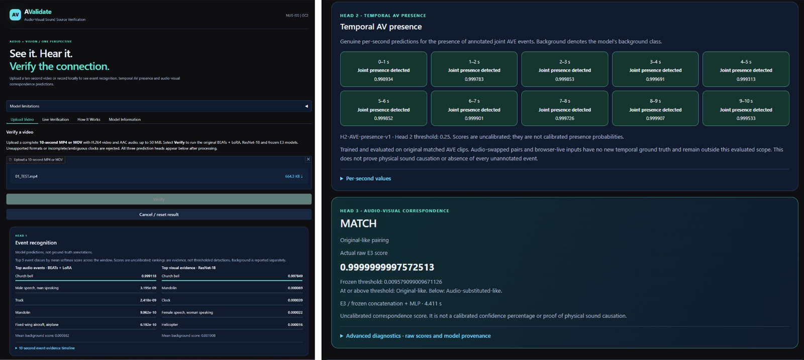
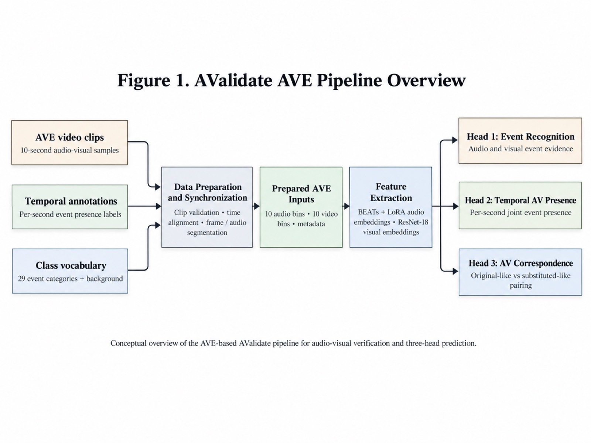
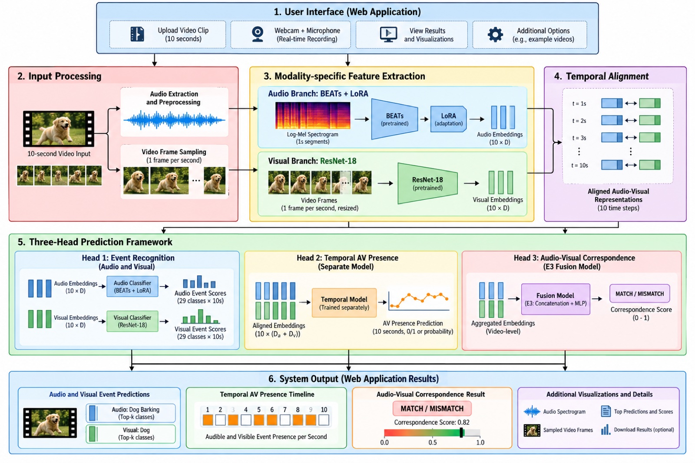
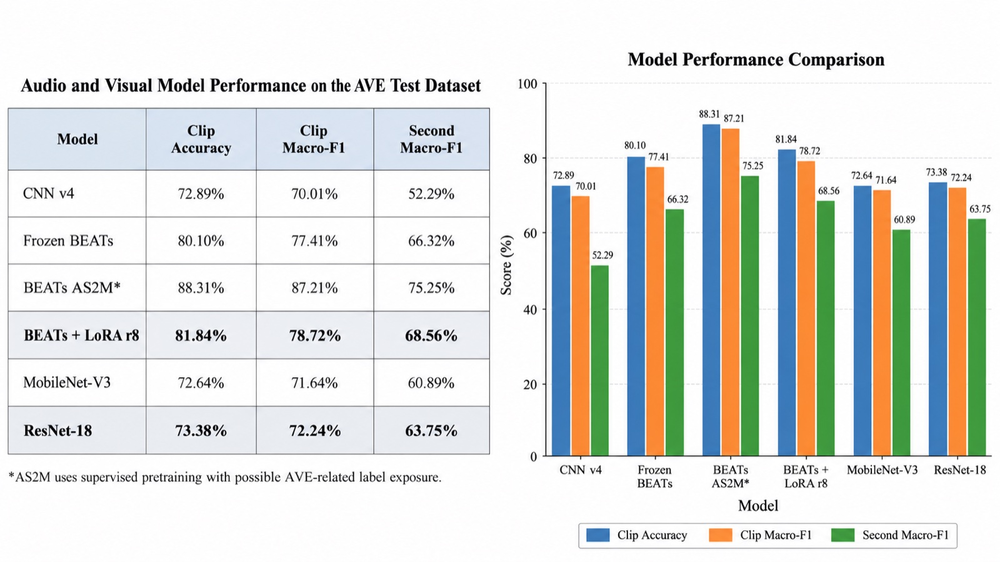
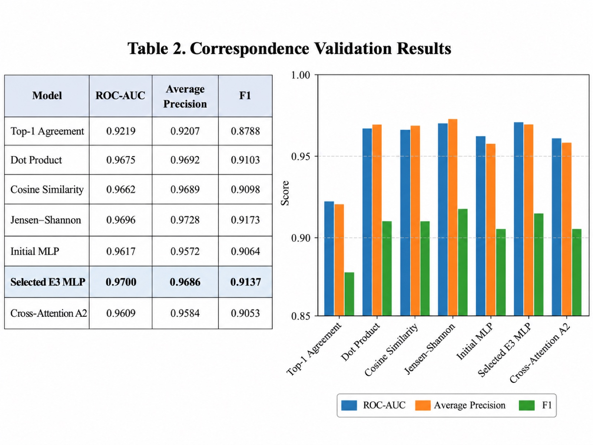
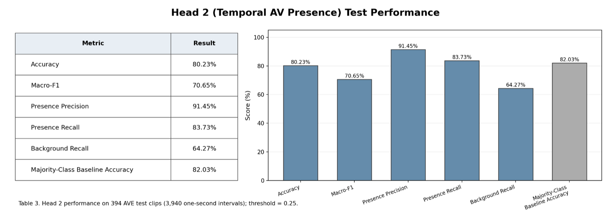

# AValidate: See it. Hear it. Verify the connection.

**Audio-visual sound-source verification.** AValidate watches and listens to a ten-second video and
answers three questions: *what* is heard and seen, *when* an event is both audible and visible, and
*whether* the soundtrack actually belongs to the video.

NUS-ISS Graduate Certificate in Pattern Recognition Systems, Practice Module, Group 25.



## Highlights

- **Three prediction heads** on one ten-second clip: event recognition, per-second audio-visual presence, and whole-clip MATCH / MISMATCH.
- **Audio:** BEATs fine-tuned with LoRA (rank 8, under 1% of parameters trained), **81.84%** clip accuracy on the AVE test set.
- **Vision:** ResNet-18, **73.38%** clip accuracy on the AVE test set.
- **Correspondence:** E3 fusion MLP, **0.970** validation ROC-AUC on 804 original vs audio-swapped pairs.
- **Temporal presence:** bidirectional GRU, **70.65%** macro-F1 on 394 source-disjoint test clips (always-present baseline: 45.06%).
- **Web app** for uploaded videos and live webcam + microphone capture, running models in an isolated, no-network Docker worker. Every checkpoint and threshold is SHA-256 pinned.

## How it works



1. **Input:** a ten-second clip, uploaded or captured live from webcam and microphone.
2. **Preprocessing:** audio is decoded to 16 kHz mono; one frame is sampled per second at 224 × 224.
3. **Audio branch:** BEATs + LoRA produces a 256-d embedding and 29 class scores for every second.
4. **Visual branch:** ResNet-18 produces a 512-d embedding and 29 class scores for every second.
5. **Three heads:**
   - **Head 1, Event Recognition:** top audio and visual events, per second, from each branch.
   - **Head 2, Temporal AV Presence:** a separately trained GRU predicts, per second, whether an event is both seen and heard (threshold 0.25).
   - **Head 3, AV Correspondence:** the E3 model concatenates both embeddings and an MLP scores the pairing as MATCH or MISMATCH (frozen threshold 0.009579).



## Results

All numbers come from the experiment logs in this repository and the team's W&B project.

### Audio and visual recognition (AVE test set, 402 clips)



| Model | Clip accuracy | Clip macro-F1 | Per-second macro-F1 |
|---|---|---|---|
| Log-Mel CNN (v4) | 72.89% | 70.01% | 52.29% |
| Frozen BEATs | 80.10% | 77.41% | 66.32% |
| **BEATs + LoRA r8 (selected)** | **81.84%** | **78.72%** | **68.56%** |
| MobileNet-V3 | 72.64% | 71.64% | 60.89% |
| **ResNet-18 (selected)** | **73.38%** | **72.24%** | **63.75%** |

A BEATs checkpoint pretrained with AudioSet labels (AS2M) scored 88.31%, but AVE clips are drawn
from AudioSet, so it may have seen our test clips. It is reported for reference only and was not
selected. Details: [audio/RESULTS.md](audio/RESULTS.md), [vision/results-video.md](vision/results-video.md).

### Audio-visual correspondence (validation, 804 pairs)



The selected E3 MLP reaches 0.970 ROC-AUC, ahead of the label-agreement baseline (0.922) and
cross-attention (0.961). Correspondence is evaluated on validation pairs; see
[docs/fusion_cross_attention_phase5_summary.md](docs/fusion_cross_attention_phase5_summary.md).

### Temporal AV presence (test, 394 clips / 3,940 seconds)



See [docs/temporal_presence.md](docs/temporal_presence.md).

## Dataset

**AVE (Audio-Visual Event)**, Tian et al., ECCV 2018: 4,143 annotated ten-second clips from 4,097
YouTube videos, 28 event categories plus background, with per-second labels. We use the official
3,339 / 402 / 402 train / validation / test split.

- Official source: <https://github.com/YapengTian/AVE-ECCV18> · Paper: <https://arxiv.org/abs/1803.08842>
- Correspondence pairs: each clip gives one original and one audio-swapped pair (6,678 train / 804 validation).
- Data audit: 45 doubly annotated videos (28 previously dropped samples restored) and 18 videos shared across splits (flagged; excluded from Head 2).

## Models, embeddings and experiment tracking

Model weights and embeddings are too large for Git. They are shared read-only on Google Drive and
verified by SHA-256 against [deployment/artifact_catalog.json](deployment/artifact_catalog.json).

| Resource | Contents | Link |
|---|---|---|
| Audio project folder | Everything below, plus feature caches | [Drive: AValidate](https://drive.google.com/drive/folders/1gOzBd-d1KlFIrLerqFrFxVWumrwKqau8) |
| Audio inference bundle | BEATs + LoRA encoder, head weights, normalisation stats, model card | [Drive: inference/audio](https://drive.google.com/drive/folders/185BtXY93QUt32gd1YVGGQ3fCeEGLXKAI) |
| Audio embeddings | `audio_final`: per-second embeddings and probabilities used by fusion | [Drive: embeddings/audio_final](https://drive.google.com/drive/folders/11FCLmW8-0Zlh-bfX8qtvDKbEKPcJgNoZ) |
| Audio training runs | CNN, BEATs and LoRA run checkpoints | [Drive: artifacts/audio_baseline](https://drive.google.com/drive/folders/1vVuBj0hG7ehQC3P9lHif5v_P69xa5-wJ) |
| Pretrained BEATs | `BEATs_iter3.pt`, `BEATs_iter3_plus_AS2M.pt` (Microsoft) | [Drive: pretrained](https://drive.google.com/drive/folders/1eBS03P-BBekW4VaMTwESTgAMWo95qNBI) |
| Video bundle | ResNet-18 inference bundle | [Drive: video bundle](https://drive.google.com/drive/folders/1KJ4tpDsyDfs2CwBPGnIKqAsQ3jgoLggN) |
| Video project folder | Root video directory: training runs, MobileNet, ResNet-18, CLIP, feature caches | [Drive: vision](https://drive.google.com/drive/folders/1agXBZB_PVXGHG6JN3TNZujVXuCZ0TkSi) |
| Video embeddings | `vision_final` (`resnet18_v1`): per-second embeddings and probabilities used by fusion | [Drive: embeddings/vision_final](https://drive.google.com/drive/folders/12wSETs-pYX0RLTS2Cx50oXc4hpBXMbVV) |
| Video parity samples | Five canonical TRAIN clips (.mp4), sampled frame arrays, and offline embeddings | [Drive: parity_samples/vision](https://drive.google.com/drive/folders/1h7vg_Tzc30uTZlMEJNE-stEw5nvM44G5) |
| Video demo | AValidate system demonstration walkthrough (NUS-ISS GC2) | [YouTube: AValidate Demo](https://www.youtube.com/watch?v=2_Hi2w5IPbE) |
| Dataset | AVE dataset (official source and download instructions) | [GitHub: AVE-ECCV18](https://github.com/YapengTian/AVE-ECCV18) |
| CoreWeave W&B | Experiment tracking: training curves, configs, evaluation artifacts | [W&B: GC2-AValidate/avalidate](https://forge.coreweave.com/wandb/GC2-AValidate/avalidate) |
| Experiment tracking | Training curves, configs, evaluation artifacts | [W&B: GC2-AValidate/avalidate](https://wandb.ai/GC2-AValidate/avalidate) |

## Running the app

Requirements: Python 3.11, Docker (Linux containers), and the verified model directory from the
links above. From the repository root:

```bash
python -m deployment.run_product_demo --models PATH_TO_VERIFIED_MODELS --private-dir PATH_TO_PRIVATE_DIR --port 7864
```

The launcher builds the image, verifies every model file against its SHA-256 hash, and starts the
web app with a separate offline model worker. Open <http://127.0.0.1:7864> and sign in with the
generated credentials saved in your private directory. Stop with Ctrl+C, or rerun with `--stop`.

Step-by-step demo (upload a MATCH clip, an audio-swapped MISMATCH clip, then a live capture):
[docs/local_three_head_demo.md](docs/local_three_head_demo.md).

The app has four tabs: **Upload Video**, **Live Verification**, **How It Works** and **Model Information**.

## Repository layout

| Path | What is inside |
|---|---|
| `audio/` | Audio extraction, log-Mel CNN, BEATs, LoRA, training, evaluation, export and inference |
| `vision/` | Frame extraction, MobileNet / ResNet-18 training, CLIP probe experiments, export and inference |
| `fusion/` | Correspondence baselines, E3 MLP, cross-attention study, temporal presence (Head 2) |
| `deployment/` | Gradio app, upload and live capture, broker, isolated inference worker, artifact catalogs |
| `notebooks/` | Colab training notebooks for the audio and vision branches |
| `tests/` | Python and JavaScript test suites |
| `docs/` | Design notes, experiment reports and handoffs |
| `Documentations/` | Proposal, presentations and project documents |

## Testing

```bash
python -m pytest tests
node --test tests/js
```

## Team

| Member | Responsibilities |
|---|---|
| Ghanashyam R K P (A0357701E) | Audio branch (CNN, BEATs, LoRA), data audit, frontend and live capture |
| Gupta Swaraj (A0357457N) | Visual branch (MobileNet, ResNet-18, CLIP experiments) |
| Veeramani Mahadevan Venkata Ganapathi Subramanian (A0355739M) | Fusion, prediction heads, integration and deployment |

## Scope and limitations

AValidate is an academic prototype trained on AVE's 28 event categories. A MISMATCH means weak
evidence that the audio and video belong together, not proof of tampering, and correspondence
scores are uncalibrated. Live capture was an extension beyond the original scope, built to test the
full-stack application; recognition on everyday webcam scenes outside AVE's categories is limited.

## References

1. Tian et al., *Audio-Visual Event Localization in Unconstrained Videos*, ECCV 2018.
2. Chen et al., *BEATs: Audio Pre-Training with Acoustic Tokenizers*, ICML 2023.
3. Hu et al., *LoRA: Low-Rank Adaptation of Large Language Models*, ICLR 2022.
4. He et al., *Deep Residual Learning for Image Recognition*, CVPR 2016.
5. Gemmeke et al., *Audio Set: An Ontology and Human-Labeled Dataset for Audio Events*, ICASSP 2017.

## AI Declaration

Generative AI tools, including OpenAI ChatGPT and Codex, Claude Code and Google Gemini, were used to
assist with system architecture review, implementation planning, code development, debugging,
testing, experimental analysis and report preparation. All AI-assisted suggestions and outputs were
reviewed by the project team. All model selections, implementation decisions, experimental results
and final submitted content remain the responsibility of the team.

## Developer documentation

- Deployment handoff (final three-head candidate): [docs/deployment_handoff_20261030.md](docs/deployment_handoff_20261030.md)
- Prediction diagnosis and known limitations: [docs/prediction_diagnosis_20261030.md](docs/prediction_diagnosis_20261030.md)
- Frontend and live capture: [docs/phase8_frontend_live.md](docs/phase8_frontend_live.md)
- Upload hardening: [docs/phase8_stage2h_upload_hardening.md](docs/phase8_stage2h_upload_hardening.md)
- Video benchmarks and CLIP experiments: [vision/results-video.md](vision/results-video.md)
- Video export handoff: [docs/video_export_handoff.md](docs/video_export_handoff.md)
- Video demo walkthrough: [YouTube: AValidate Demo](https://www.youtube.com/watch?v=2_Hi2w5IPbE)

The default Docker entry point remains the gated application; the authenticated product demo above
is the supported way to run predictions locally. The earlier research Streamlit prototype is `app.py`.
